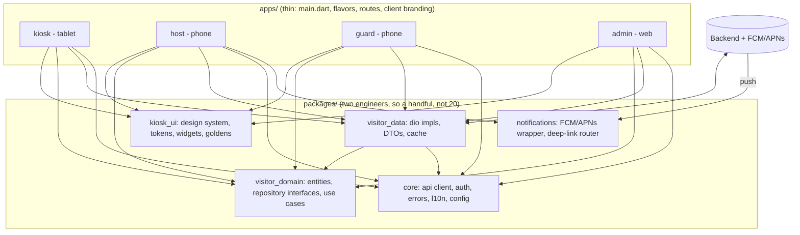

# Section C — Architecture: one codebase, four apps

## Diagram

## 1. Code sharing

A **monorepo** (Melos or Dart pub workspaces) with `apps/{kiosk,host,guard,admin}` and `packages/{core,visitor_domain,
visitor_data,kiosk_ui,notifications}`. **Shared:** domain entities and repository interfaces, the API client/DTOs, auth, error
model, l10n strings, design system, router helpers. This repo's `domain`/`data`/`presentation` split is already that boundary.
**Deliberately not shared:** screens and navigation (each app's flows differ), per-app state wiring, platform integrations that
only one app needs (camera/QR scanning in guard, kiosk idle/lock mode, web-only admin tables). I'd also resist a package per
feature: with two engineers every extra package is build and review overhead. Shared code goes through a code owner and a
changelog so a change for the host app can't silently break the kiosk. Backend DTOs live in one place (ideally generated from an
OpenAPI spec) so four apps don't each drift.

## 2. Design system

**Tokens, not widgets, are the unit of branding.** A `BrandTheme` (colours, shape, typography, logo, product name) is data,
loaded per client from build-time config (`--dart-define`/flavor file) for white-label app-store builds and from the backend at
runtime for multi-tenant. It feeds `ColorScheme.fromSeed` plus a `ThemeExtension` for non-Material tokens. The component library
(`kiosk_ui`) only reads tokens, never hard-coded colours, and every component takes `Semantics`, 48 dp targets and text-scale
behaviour as part of its contract. **Regression prevention:** golden tests per component × {light, dark} × {1×, 2× font} ×
{en, hi, gu} × {2–3 sample brands}, run in CI on one pinned Flutter version and OS (fonts differ otherwise), with a
reviewed-update workflow; plus a widget-gallery app to look at things by hand. This repo's badge goldens and overflow tests are
the seed of that suite. Contrast checks on a client's brand colour run at build time, since a client can pick an unreadable one.

## 3. Navigation and deep links

`go_router` with **path-based, typed routes** per app (`/visitors/:id/approve`, `/admin/visitors/:id`), so a URL is the single
description of a screen. Web admin gets real shareable URLs (path URL strategy, IIS/SPA rewrite). Notification payloads carry
only `type` and `visitorId`; the tap handler maps them to a route, and the screen **fetches** the visitor by id instead of
trusting payload data. Auth is a `redirect`: unauthenticated links go to login and then resume the original target. Android App
Links / iOS Universal Links share the same route table for links from email or SMS. Cold start from a notification uses
`getInitialMessage`; warm uses `onMessageOpenedApp`; both feed one `DeepLinkController` so there's one tested code path.

## 4. Arrival notifications (within seconds)

Polling and sockets can't do this reliably when the app is backgrounded or closed, so use **FCM** (Android) and **APNs via FCM**
(iPhone). Server flow: kiosk check-in → backend → push to the host's registered device tokens (token registered per user and
refreshed on login/rotation). **Foreground:** FCM `onMessage` shows an in-app banner/updates the list directly (and could use
a socket/SSE for richer live updates later). **Background:** a *notification message* with high priority (`priority: high` /
APNs `apns-priority: 10`) is displayed by the OS even if the app is not running; tapping opens the approval route. **Fully
closed:** same OS-displayed push; the tap launches the app and `getInitialMessage` routes to the visitor. Use a high-importance
Android notification channel (created at start), request iOS/Android 13 permission with an explanation, and for approve/deny
use notification actions (handled by a background isolate hitting the API). Caveats to plan for: OEM battery optimisers on
cheap Android 9 devices can delay or kill delivery (document the whitelisting steps, and fall back to the list refreshing on
resume), pushes are best-effort so the host app must also load pending approvals on open, and the kiosk tablets (2 GB, Android 9) never need push at all.

## 5. Month 1 vs. deferred a year

**Month 1 (two engineers):**
1. Monorepo + the `core`, `visitor_domain`, `visitor_data` packages extracted from the kiosk (it already has the layering);
   CI with analyze, tests and goldens.
2. `kiosk_ui` tokens + the ~10 components the kiosk already uses, with **one** brand switchable at runtime. Not per-client builds yet.
3. **Host app MVP and push**: FCM, token registration, arrival notification, deep link to approve/deny. This is the riskiest and
   most valuable piece, so it goes first and is tested on a real low-end device, in all three app states.
4. Guard app: QR scan + check status (small, reuses the badge `badgeCode`).
5. Admin: read-only visitor list at a deep-linkable URL, hosted properly on IIS (compression, MIME, rewrite).

**Deferred:** per-client **app store listings** and an automated white-label build pipeline (do a manual flavour for the first
client that pays for it); a full multi-tenant theme server; deferred-component splitting and Wasm tuning for admin;
offline queueing/sync for check-ins; a socket/live channel; visual regression across every brand; in-app analytics and
crash-dashboards beyond Crashlytics; Hindi/Gujarati for the host/guard apps beyond strings already shared; iOS kiosk; push
actions (approve from the notification shade). **Why this cut:** the enterprise promise is "host notified in seconds" and
that is a delivery-reliability problem to retire early; branding and store listings are packaging problems that are cheap to
add once the shared packages are stable and expensive to automate before we know what clients actually vary.
